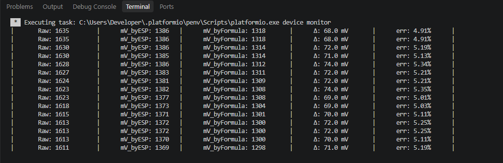

# Homework for module 1.6

#### Worked with ADC, voltage divider, photoresistor.

Results of measurement:

## Conclusion

As we can see, the deviation of the voltage calculation from the built-in function fluctuates on average ~5%.